# Joint Tuner

> Submitted at commit [`d16b732`](../../tree/d16b732). Later commits add figures and documentation only (charts, significance plots, business case); no result changed.

**A small open model, fine-tuned on Fireworks, that tunes robot-joint controllers in a handful of physical tests.**

On 100 held-out ControlEval tasks, Joint Tuner matches GPT-6.1 Terra (90 vs 89) and the best open model, Kimi K3 with thinking (90), at 3 to 4 times less model time than GPT and about 35 times less than Kimi. When physical tests are scarce it is far ahead of a classic optimizer: **76 vs 27 tasks solved with 8 step tests** (+49 points, 95% CI 38 to 59, McNemar p = 3e-13). Fine-tuning on Fireworks for $5.11 took the 35B open model from 20 to 50 on its first answer (p = 3e-6).

**Hypothesis.** A small open model, fine-tuned on Fireworks on simulator-verified designs and paired with a simulator check, can tune real joints as accurately as a frontier model, faster, and with far fewer physical tests than a classic optimizer.

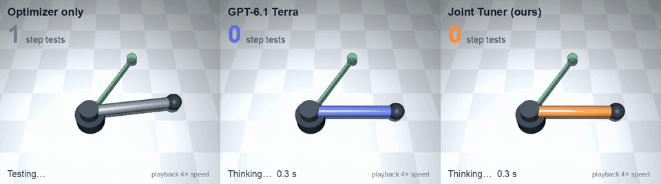

*One held-out wrist joint, rendered in MuJoCo, with each tuner's logged gains replayed at 4× speed. Optimizer only: 493 step tests. GPT-6.1 Terra: right on its first test, after 23 s of thinking. Joint Tuner: right on its 5th test. The 1 s model wait shown is the Fireworks model's median latency (1.35 s); the logged River call for this task took 9 s.*

Demo video: [media/joint_tuner_demo_silent.mp4](media/joint_tuner_demo_silent.mp4)

## 1. The task and who it is for

Every robot joint, conveyor axis, gimbal and drone attitude axis runs a feedback controller (proportional, integral and derivative gains) that has to be tuned to a spec: stable, fast enough, small overshoot, no steady error. Today a technician does that by hand with step tests: move the joint, measure, adjust, repeat. Each test costs time and wear, and a bad gain set can slam or oscillate real hardware.

| | |
|---|---|
| Who does it | Commissioning and controls technicians. US electro-mechanical and mechatronics technicians earn a median $35.53 an hour ([BLS](https://www.bls.gov/ooh/architecture-and-engineering/electro-mechanical-technicians.htm)). |
| How many machines | 542,000 industrial robots were installed worldwide in 2024 and more than 600,000 in 2025 ([IFR World Robotics](https://ifr.org/ifr-press-releases/news/global-robot-demand-in-factories-doubles-over-10-years)). A 6-axis arm has 6 to 18 nested loops. Humanoids add 20 to 40 joints each. |
| Why frontier models are not enough | GPT-6.1 Terra is accurate (89/100) but thinks about 19 s per loop and must call a cloud API. Kimi K3 matches it at 222 s per loop. Neither runs next to the machine. |
| Why a fine-tuned small open model | Same accuracy, about 1 s per loop on Fireworks, open weights that can run on-site, and it is trained on simulator-verified designs so every training label is feasible. |

**Value, with the assumptions written out.** Assume a technician spends 20 minutes per loop by hand (assumption) and an arm has 12 loops: 4 hours per robot, about $142 at the BLS median wage. If Joint Tuner cuts that to 5 minutes per loop (assumption, based on a median of 1 to 5 step tests), it saves about $107 per robot. Across 100,000 robots a year (a sixth of annual installs), that is about $10.7M a year in technician time, before counting wear and downtime. Replace these assumptions with numbers from a real integrator.

The physics behind each task and how it maps to arms, actuators, humanoids and drones: [docs/physical-model.md](docs/physical-model.md).

## 2. How it works

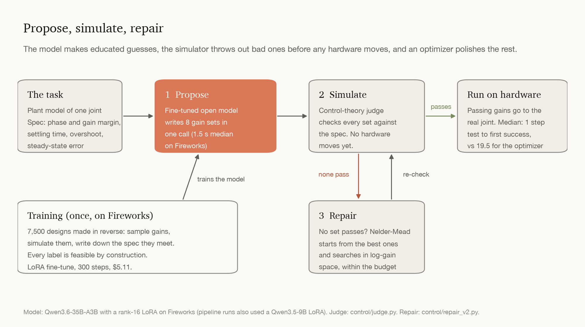

1. **Propose.** A fine-tuned open model writes 8 candidate gain sets in one call (1.5 s median on Fireworks; 1.35 s for a single answer).
2. **Simulate.** A control-theory judge (`control/judge.py`) checks each set: gain margin, phase margin, settling time, overshoot, steady-state error. That judge is the same one ControlEval uses to score.
3. **Repair.** If none pass, Nelder-Mead polishes the best candidates in log-gain space under a fixed test budget. Repair v2 falls back to the optimizer's own restart schedule once the model's seeds are used up.

**Training data.** 7,500 reverse-generated examples, 1,500 of them drone axes (`control/gen_synth.py`, `control/gen_drone.py`): sample gains, simulate them, and write the spec they meet, so every label is feasible by construction. The evaluation tasks are the official ControlEval tasks, never used for training.

**Models.** The production model, `pid-tuner-q36v3`, is Qwen3.6-35B-A3B with a rank-16 LoRA, trained and evaluated with the Fireworks serverless training API and promoted to a Fireworks model. A dedicated deployment for live serving failed at creation with a Fireworks internal error during the event, so all Fireworks numbers come from the training session's sampler. The pipeline experiments (budget curve, repair, MuJoCo demos) were run with a Qwen3.5-9B LoRA trained on River during development. Every row says which model it uses.

## 3. Results on the same 100 held-out tasks

All results use 100 held-out tasks from ControlEval (arXiv 2410.19811), 10 categories × 10, scored by the same judge with the same prompt for every system.

### Leaderboard

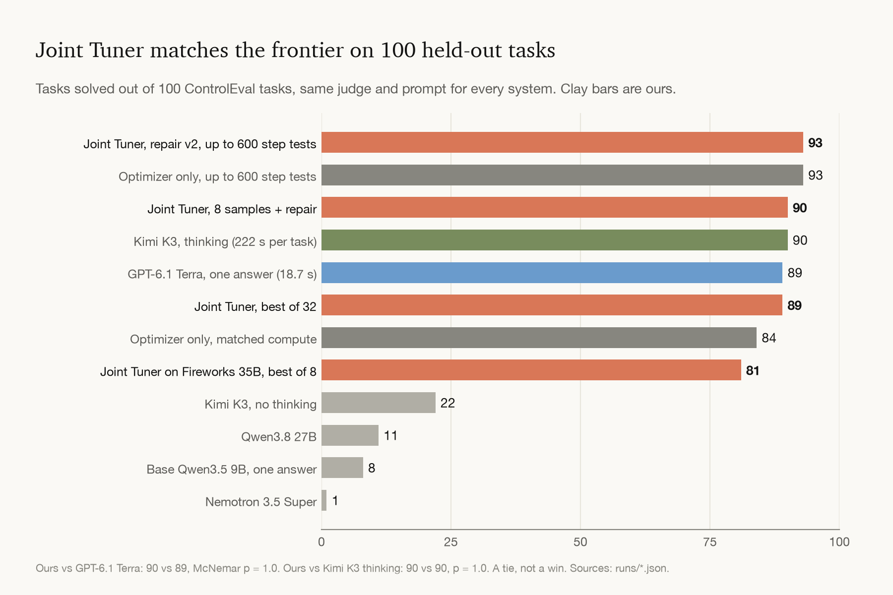

| System | Solved | Median model time | Notes |
|---|---|---|---|
| **Joint Tuner, repair v2, up to 600 tests** | **93** | | ties optimizer only at 600 tests on the same 93 tasks |
| Optimizer only, up to 600 tests | 93 | none | needs a median of 19.5 tests per task |
| **Joint Tuner, 8 samples + repair** | **90** | 6.3 s | |
| Kimi K3 with thinking (open, up to 100k tokens) | 90 | 222 s | p = 1.0 vs Joint Tuner |
| GPT-6.1 Terra, one answer | 89 | 18.7 s | about $0.008 per task; p = 1.0 vs Joint Tuner |
| **Joint Tuner, best of 32** | **89** | 4.9 s | |
| Optimizer only, matched budget (3 × 150) | 84 | 9.4 s | Joint Tuner wins 6 to 0, p = 0.031 |
| **Joint Tuner on Fireworks (35B), best of 8** | **81** | 1.5 s | 1.35 s for a single answer |
| Kimi K3, no thinking | 22 | | |
| Qwen3.8 27B | 11 | | |
| Base Qwen3.5 9B | 8 (one answer) / 41 (best of 8) | | |
| Nemotron 3.5 Super | 1 | | |

### Main figure: tasks solved vs. physical tests allowed

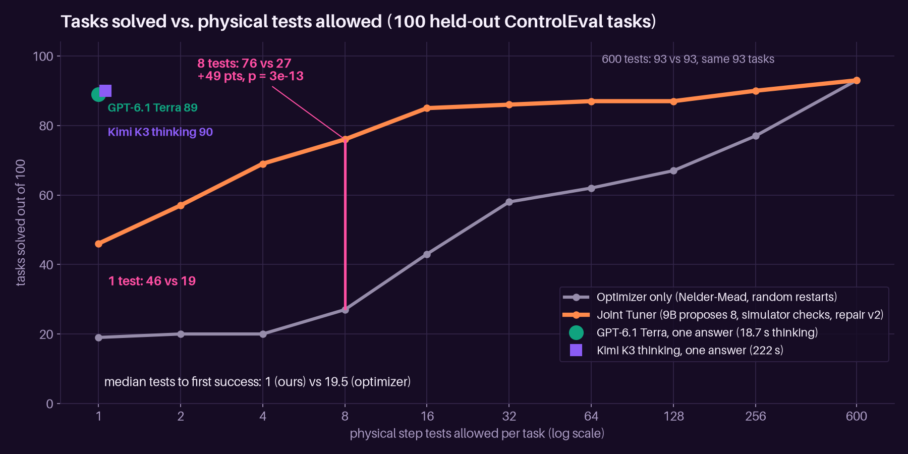

| Step tests allowed | 1 | 2 | 4 | 8 | 16 | 32 | 64 | 128 | 256 | 600 |
|---|---|---|---|---|---|---|---|---|---|---|
| **Joint Tuner** (repair v2) | **46** | **57** | **69** | **76** | **85** | **86** | **87** | **87** | **90** | 93 |
| Optimizer only | 19 | 20 | 20 | 27 | 43 | 58 | 62 | 67 | 77 | 93 |

- Joint Tuner leads at every budget from 1 to 256 tests, all significant after a Holm correction.
- Median tests to first success, on the 90 tasks both solve: **1** (IQR 1 to 3.75) vs **19.5** (IQR 6 to 166), Wilcoxon p ≈ 1e-10.
- Area under the curve up to 256 tests: 0.77 vs 0.43, difference +0.34 [0.26, 0.42].
- Repair v2 closes the large-budget gap (the original repair stopped at 90 while the optimizer reached 93). Caveat: v2 was chosen on these same 100 tasks, the +3 comes from 3 unstable tasks, and on 2 of them it reaches the optimizer's answer later than the optimizer does.
- Sources: `control/budget_trace.py` → `runs/trace_v3.json`, `control/repair_v2.py` → `runs/trace_v3_repair2.json`.

### Speed

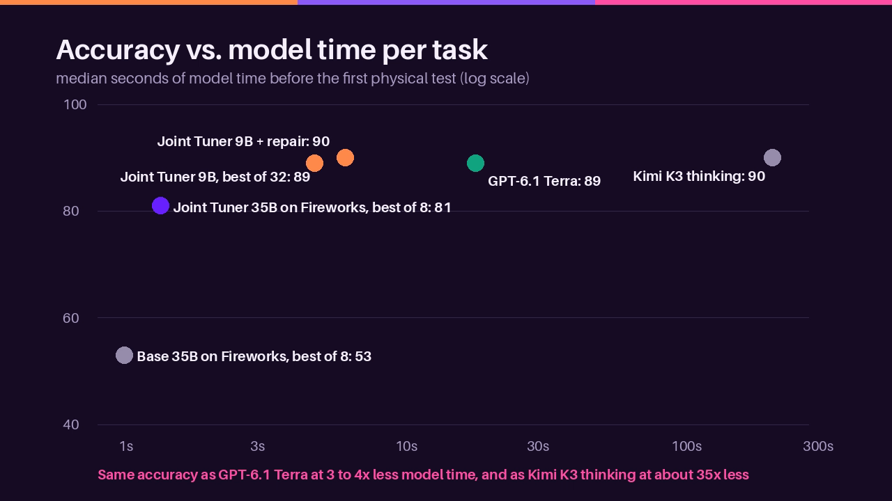

### Fine-tuning on Fireworks

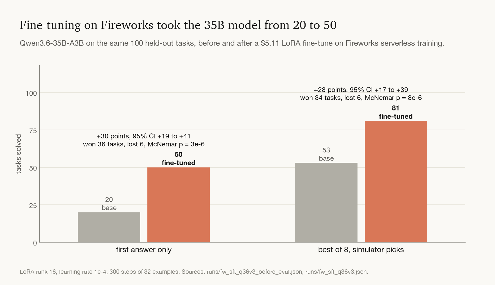

| Qwen3.6-35B-A3B on the same 100 tasks | First answer | Best of 8, simulator selects |
|---|---|---|
| Base | 20 | 53 |
| **Fine-tuned on Fireworks** (`pid-tuner-q36v3`) | **50** | **81** |
| Disagreements won / lost | 36 / 6, p = 3e-6 | 34 / 6, p = 8e-6 |
| Gain, bootstrap 95% CI | +30 [+19, +41] | +28 [+17, +39] |

LoRA rank 16, learning rate 1e-4, 300 steps × batch 32, Fireworks serverless training, $5.11. Sources: `control/fw_sft.py`, `runs/fw_sft_q36v3.json` (after), `runs/fw_sft_q36v3_before_eval.json` (before).

### How each idea moved the score

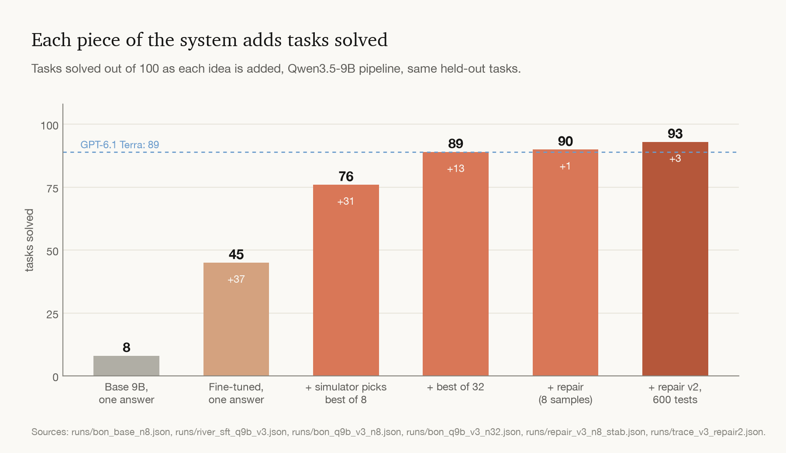

## 4. Is the gain real?

We run both tests from the sample submission on every comparison: exact McNemar on the disagreements, and a paired bootstrap that resamples the 100 tasks 10,000 times. A gain counts as real only when both agree. Script: `stats/figures.py` (also writes `docs/figures/comparisons.json`).

**McNemar, worked for the headline comparison** (Joint Tuner vs optimizer only, 8 step tests):

| | Optimizer right | Optimizer wrong |
|---|---|---|
| **Joint Tuner right** | 25 (both right, ignored) | **51** (only Joint Tuner) |
| **Joint Tuner wrong** | **2** (only optimizer) | 22 (both wrong, ignored) |

If the two were equally good, the 53 disagreements would split about 26 to 27 like a coin. A 51 to 2 split has p = 3e-13.

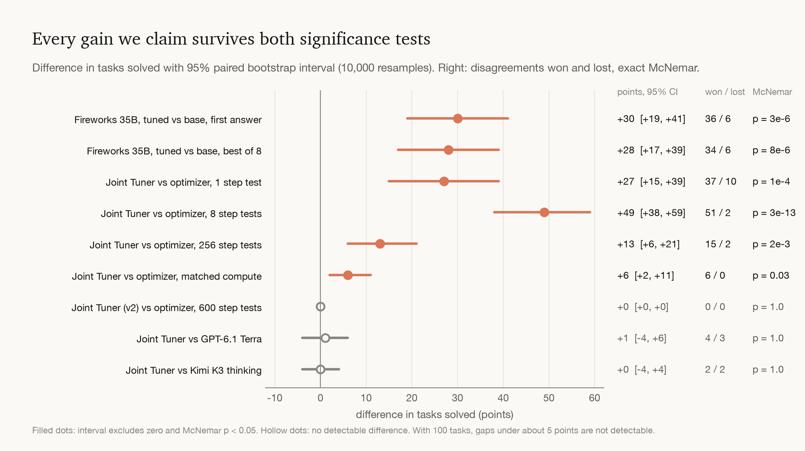

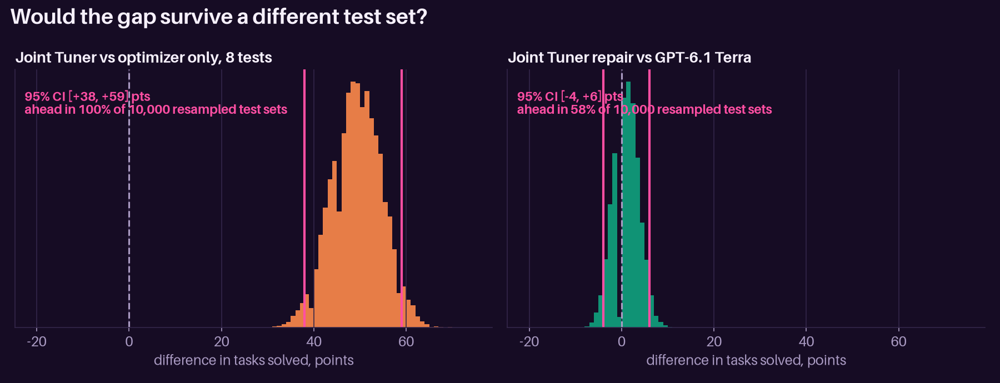

| Comparison | Score | Won / lost | McNemar p | Gain, 95% CI | Verdict |
|---|---|---|---|---|---|
| Fireworks fine-tune vs base, first answer | 50 vs 20 | 36 / 6 | 3e-6 | +30 [+19, +41] | real |
| Fireworks fine-tune vs base, best of 8 | 81 vs 53 | 34 / 6 | 8e-6 | +28 [+17, +39] | real |
| Joint Tuner vs optimizer, 1 test | 46 vs 19 | 37 / 10 | 1e-4 | +27 [+15, +39] | real |
| Joint Tuner vs optimizer, 8 tests | 76 vs 27 | 51 / 2 | 3e-13 | +49 [+38, +59] | real |
| Joint Tuner vs optimizer, 256 tests | 90 vs 77 | 15 / 2 | 0.002 | +13 [+6, +21] | real |
| Joint Tuner (v2) vs optimizer, 600 tests | 93 vs 93 | 0 / 0 | 1.0 | 0 | tie |
| Joint Tuner repair vs optimizer, matched budget | 90 vs 84 | 6 / 0 | 0.031 | +6 [+2, +11] | real |
| Joint Tuner repair vs GPT-6.1 Terra | 90 vs 89 | 4 / 3 | 1.0 | +1 [−4, +6] | not different |
| Joint Tuner repair vs Kimi K3 thinking | 90 vs 90 | 2 / 2 | 1.0 | 0 [−4, +4] | not different |

We claim we **match** the frontier and the best open model on accuracy, not that we beat them. With 100 tasks, only gaps of about 5 to 6 points or more are detectable. Tasks are resampled one at a time; there are only 10 categories, too few to resample as clusters.

## 5. Robustness to model mismatch

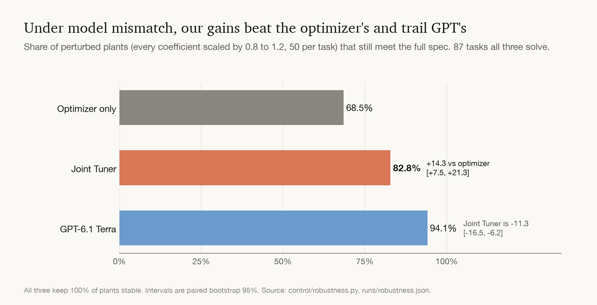

Real joints never match their model. We perturbed every plant coefficient by up to ±20%, with 50 random plants per task, and re-checked each method's final gains on the 87 tasks all three solve (`control/robustness.py`, `stats/ROBUSTNESS.md`).

| Gains from | Still stable | Still meets full spec |
|---|---|---|
| Optimizer only | 100% | 68.5% |
| **Joint Tuner** | 100% | **82.8%**, +14.3 vs optimizer [+7.5, +21.3] |
| GPT-6.1 Terra | 100% | 94.1%, Joint Tuner is −11.3 [−16.5, −6.2] |

GPT's gains are significantly more robust than ours. A likely reason: our repair stops at the first passing gain set, which often sits at the edge of the spec. Choosing the most robust passing candidate is the next fix.

## 6. What lost

- **Greedy single answer.** Only 45 to 50%. The simulator check is what makes the system reliable.
- **Bigger N alone.** Best of 32 reaches 89. Best of 8 plus repair reaches 90 with 4× fewer model samples.
- **Repair with a flat instability penalty.** It gave the optimizer no direction on unstable plants. A smooth pole-based penalty plus derivative-heavy seeds moved unstable tasks from 10/20 to 12/20, but cost a median of 130 s per task.
- **Second-order unstable plants** remain the weakest category (1 to 2 of 10 in the first run, 4 with repair v2, vs 4 for GPT-6.1 Terra). Five second-order unstable tasks are unsolved by every system we ran (Joint Tuner, optimizer only, GPT-6.1 Terra, Kimi K3 thinking).
- **Kimi K3 with thinking** truncated at 16k tokens on 60/100 tasks. We re-ran those at 100k tokens so the baseline is not unfairly weakened (`control/rerun_truncated.py`).
- **Fireworks SFT run 1** (400 steps) was lost: the checkpoint name contained an underscore, which the API rejects. The script now sanitizes names, saves every 100 steps, and deletes the session only after promotion.
- **Fireworks on-demand deployment** of the LoRA failed at creation (internal error), so we could not measure live serving cost.

## 7. How it scales and improves itself

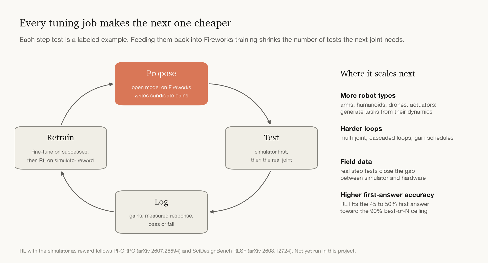

Every tuning job produces labeled data: the gains tried, the measured response, and whether it met spec. Fed back into Fireworks training (supervised fine-tuning on the successful designs, then RL with the simulator as the reward, as in PI-GRPO, arXiv 2607.26594), each job makes the next one need fewer tests. The same recipe extends to new robot types by generating tasks from their dynamics, to multi-joint and cascaded loops, and to field data that closes the gap between simulator and hardware.

## 8. Where it runs on real hardware

In each scene the **orange unit** is simulated in MuJoCo with the exact dynamics of a held-out task (inertia, damping, stiffness and motor gain from its transfer function; the drone adds rotor lag), driven by Joint Tuner's gains. Each meets its spec in both the judge and MuJoCo. The rest of the body is fixed.

| Actuator (gearbox output, real time) | Robot arm elbow (37× speed) |
|---|---|
| 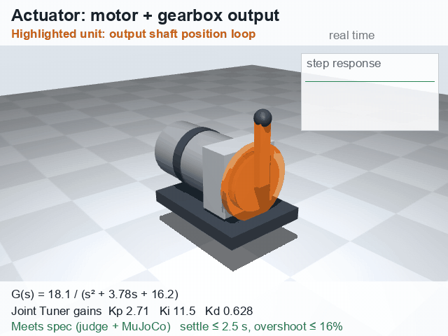 | 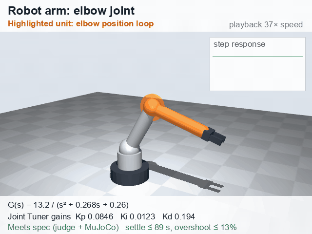 |
| **Humanoid ankle, unstable (real time)** | **Drone roll axis with rotor lag (2× speed)** |
| 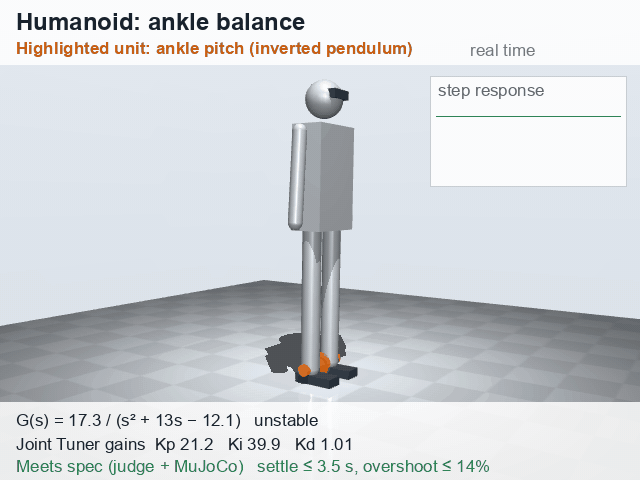 | 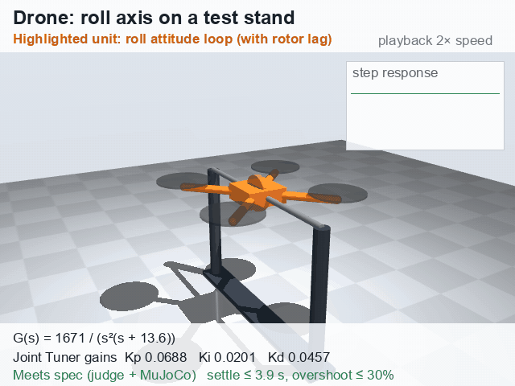 |

MP4s: [actuator](media/actuator.mp4), [robot arm](media/robot_arm_elbow.mp4), [humanoid](media/humanoid_ankle.mp4), [drone](media/drone_roll.mp4), [unstable joint race](media/mujoco_pendulum.mp4). The drone task is held-out but synthetic, from the same generator as part of the training data.

## 9. How this project maps to the rubric

| Criterion | Weight | What this project shows | Where it would lose points |
|---|---|---|---|
| Benchmark evaluation | 40% | Same 100 held-out tasks for 12 systems; Fireworks fine-tune before vs after (+30, p = 3e-6); frontier baseline GPT-6.1 Terra and the strongest open baseline Kimi K3 thinking, both run fairly; McNemar and bootstrap on every comparison; losses reported | 100 tasks gives limited power for small gaps; repair v2 chosen on the same tasks; pipeline numbers use the River-trained 9B, not the Fireworks 35B |
| Business value | 25% | Named users with a BLS wage, IFR install counts, value math with assumptions written out, a physical cost (step tests) as the x-axis | No interview with an integrator; assumptions on minutes per loop are ours |
| Technical execution | 20% | Reverse-generated feasible training data, Fireworks serverless training, propose-simulate-repair with an ablation against the optimizer alone, robustness study, MuJoCo renders that agree with the judge | Live Fireworks deployment failed, so no measured serving cost; one training seed |
| Presentation | 10% | Demo video, tuning race, four hardware scenes, annotated charts | Demo uses replayed logs, not a live model call |
| Documentation | 5% | Run order, raw per-task results for every number, `requirements.txt`, fresh-clone check reproduces the optimizer-only 84/100 task by task | 9B training needs the private River SDK |

## Sources

- ControlEval and ControlAgent: Guo et al., arXiv 2410.19811 (benchmark tasks and judge criteria).
- PI-GRPO PID tuning with LLM agents, arXiv 2607.26594; CoDyControlBench, arXiv 2608.07004; hybrid LLM warm-start calibration, arXiv 2610.22379; SciDesignBench RLSF, arXiv 2603.12724. Notes in [docs/related-work.md](docs/related-work.md).
- [BLS Occupational Outlook: Electro-mechanical and Mechatronics Technologists and Technicians](https://www.bls.gov/ooh/architecture-and-engineering/electro-mechanical-technicians.htm).
- [IFR World Robotics 2025 press release](https://ifr.org/ifr-press-releases/news/global-robot-demand-in-factories-doubles-over-10-years) and [World Robotics 2026 press release](https://ifr.org/ifr-press-releases/news/five-million-robots-now-operate-in-factories-globally).
- [Fireworks serverless training docs](https://docs.fireworks.ai/fine-tuning/training-api/serverless).

## Reproduce

Run everything from the repo root; scripts use relative paths (`control/`, `runs/`, `data/`).

```bash
python -m venv .venv && . .venv/bin/activate
pip install -r requirements.txt
./fetch_controleval.sh        # ControlEval is fetched from upstream, not redistributed
```

**No API keys needed.** These check the published numbers from the logged results in `runs/`:

```bash
python stats/significance.py                                  # McNemar + bootstrap -> runs/significance.json
python stats/budget_stats.py                                  # budget-curve stats -> runs/budget_stats.json, stats/RESULTS.md
python control/coldstart_ablation.py 150 3                    # optimizer-only ablation, ~minutes on a laptop -> runs/coldstart_150x3.json
python control/gen_synth.py 7500 data/pid/train_new.jsonl 0   # reverse-generated, simulator-verified SFT data (N OUT SEED)
python demo/build_race.py && open demo/race.html              # web demo
python demo/mujoco_race.py second_order_stable_fast/6 media/mujoco_wrist.mp4   # MuJoCo race render
python demo/mujoco_units.py                                   # the four hardware scenes in media/
```

**Needs keys** (`cp .env.example .env` and fill in your own):

```bash
python control/fw_sft.py 300 32 10 q36v3                      # FIREWORKS_API_KEY: serverless LoRA SFT + before/after eval
python control/closed_baseline.py openai gpt-6.1-terra 10     # OPENAI_API_KEY: frontier baseline
FW_MODEL=accounts/<acct>/models/<model> python control/propose_repair.py Qwen/Qwen3.5-9B - 8 1.0 v3   # propose -> simulate -> repair
FW_MODEL=accounts/<acct>/models/<model> python control/budget_trace.py - 8 v3                         # main figure data
```

### What needs River

The 9B rows (`runs/river_sft_*`, `runs/bon_*`, `runs/repair_*`, `runs/trace_v3.json`) were sampled through River, a private training/sampling SDK (`river_client`) that is not public. Those raw outputs are all in `runs/`, and every downstream number (judge, stats, demos) recomputes from them without River.

- `control/river_sft.py`, `control/bestofn.py` and `control/eval_file.py` (any mode other than `chat`) need River. The first two exit with a message if it is missing.
- `control/propose_repair.py` and `control/budget_trace.py` run without River when `FW_MODEL` points at a Fireworks model. That reproduces the pipeline, not the exact 9B numbers.
- `control/gen_synth.py` was run with an unrecorded seed, so a regenerated file will differ from `data/pid/train_v3.jsonl` (which is included).

## Layout

- `control/judge.py`: the ControlEval-style spec checker, which is also the reward.
- `control/gen_synth.py`: training data. Labels come from sampled gains whose specs are derived backward, so every label is feasible.
- `control/propose_repair.py`: the propose → simulate → repair pipeline.
- `control/fw_sft.py`: Fireworks serverless training, evaluation and promotion.
- `demo/mujoco_units.py`: renders the four hardware scenes, with the tuned unit highlighted.
- `demo/mujoco_race.py`: renders the race in MuJoCo, with each plant built as a hinge joint (inertia, damping, stiffness, motor gear).
- `docs/physical-model.md`: transfer function ↔ joint physics, plus the category-to-hardware map for arms, humanoids and drones.
- `demo/race.html`: "How many tries does it take to tune a motor?" Three tuners race on the same motor.
- `docs/related-work.md`: the papers we built on and what we took from each.
- `runs/`: raw per-task results for every number above.

## Related work

ControlAgent (2410.19811), PI-GRPO PID tuning (2607.26594), CoDyControlBench (2608.07004), hybrid LLM warm-start calibration (2610.22379), and SciDesignBench RLSF (2603.12724). See `docs/related-work.md`.
