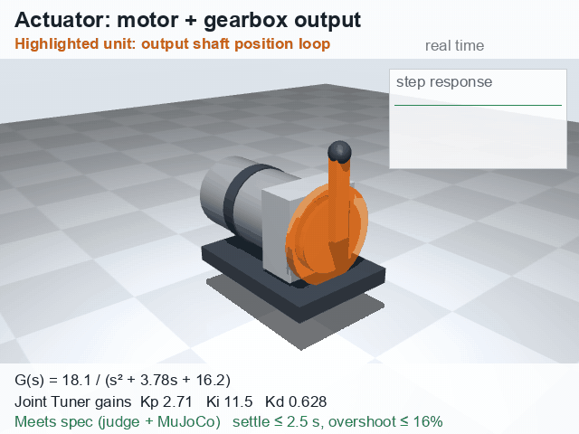
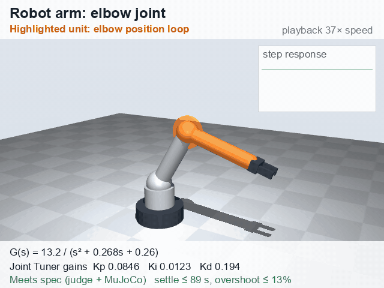
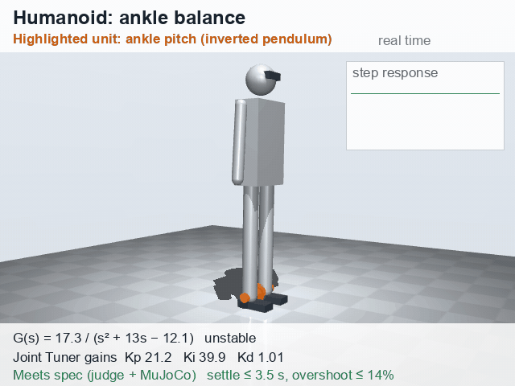
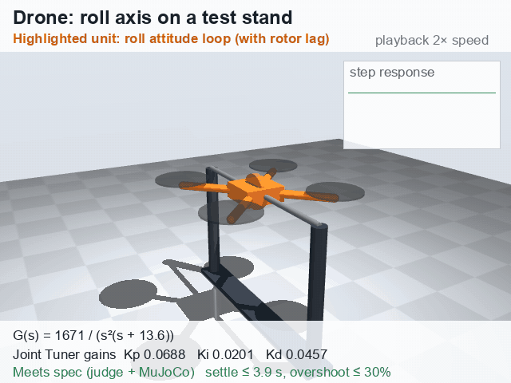

# From a transfer function to a real joint

Every ControlEval task is a plant written as a transfer function, `G(s) = num / den`. This page shows what those numbers mean physically. It also shows why the same tuning problem shows up in robot arms, humanoids and drones.

## One joint, one equation

A motor-driven joint obeys Newton's second law for rotation:

```
J·θ''  +  b·θ'  +  k·θ  =  K·u
inertia   friction  spring   motor torque per unit command
```

Taking the Laplace transform gives the plant the tuner sees:

```
G(s) = θ(s) / u(s) = K / (J s² + b s + k)
```

Normalizing by J gives exactly ControlEval's second-order form `num / (s² + a s + c)`:

| Term in G(s) | Physical meaning | Where it comes from on a robot |
|---|---|---|
| `num` = K/J | torque per command ÷ inertia | motor torque constant × gear ratio, link mass and length |
| `a` = b/J | damping | bearing friction, gearbox losses, back-EMF |
| `c` = k/J > 0 | restoring stiffness | series-elastic springs, cable tension, gravity hanging *below* the pivot |
| `c` = k/J < 0 | anti-stiffness (unstable) | gravity with the load *above* the pivot: an inverted pendulum, a balancing humanoid |

The PID controller `C(s) = Kp + Ki/s + Kd·s/(0.01s+1)` closes the loop:
- **Kp** pulls the joint toward the target.
- **Ki** removes steady offset, for example a load the motor must hold.
- **Kd** adds damping, so the joint doesn't overshoot or oscillate.

## The MuJoCo demo uses exactly this mapping

`demo/mujoco_race.py` builds each task as a MuJoCo hinge joint:
- inertia 1, joint `damping = a`, joint `stiffness = c` (negative for the unstable tasks), and motor `gear = num`;
- it then runs each tuner's logged gains through a PID with the benchmark's derivative filter.

Physics engine and benchmark agree: each tuner's final gains pass the judge and settle on target in MuJoCo.

| Clip | What happens |
|---|---|
| `media/mujoco_wrist.mp4` | **Wrist joint** (`second_order_stable_fast/6`). The optimizer flails for 493 step tests. GPT-6.1 Terra thinks for 23 s, then succeeds on its first test. Joint Tuner succeeds on its 5th test; the model wait shown is the Fireworks median latency. |
| `media/mujoco_pendulum.mp4` | **Unstable joint** (`second_order_unstable/7`, negative stiffness, so the joint falls away from center unless it's controlled). Optimizer: 291 tests. GPT-6.1 Terra: 1 test. Joint Tuner: 14 tests. This is our weakest category, and we show it anyway. |

## Rendered: the same tuning problem on four machines

| | |
|---|---|
|  |  |
|  |  |

Each scene is also available as its own video: [actuator](../media/actuator.mp4), [robot arm](../media/robot_arm_elbow.mp4), [humanoid](../media/humanoid_ankle.mp4), [drone](../media/drone_roll.mp4).

`demo/mujoco_units.py` builds each orange unit from a task's transfer function:
- **Hinge-joint scenes:** inertia 1, damping a, stiffness c, gear K.
- **Drone:** a filter actuator with time constant 1/a, which models rotor spin-up lag.

It runs Joint Tuner's gains through the benchmark's PID and plots the step response in the corner. On the humanoid, negative stiffness *is* gravity: the body falls unless the ankle controller holds it.

## What the ControlEval categories correspond to

| ControlEval category | Plant form | Real hardware it models |
|---|---|---|
| first-order stable (fast/moderate/slow) | K/(τs+1) | velocity loop of a DC motor, conveyor speed, heater |
| first-order with delay | K·e^(−θs)/(τs+1) | a motor with sensor or communication lag (CAN bus, vision feedback) |
| first-order unstable | K/(τs−1) | a balancing platform; a thermal-runaway loop |
| second-order stable (fast/moderate/slow) | K/(s²+as+c) | position loop of a wrist, elbow or shoulder joint; a gimbal axis |
| second-order unstable | K/(s²+as−c) | an inverted pendulum, a cart-pole, the ankle or hip of a balancing humanoid |
| higher-order | three or more poles | a flexible link or belt drive: motor + compliance + load |

## Why this matters beyond one joint

**Robot arms.**
- A 6-axis arm has 6 to 18 nested loops: current, velocity and position, per joint.
- Each joint's inertia changes with pose and payload, so gains are re-tuned at commissioning and whenever the tool changes.
- Today that means an engineer running step tests one at a time.

**Actuators.**
- Every new motor, gearbox and load combination needs tuning: robot joints, CNC axes, camera gimbals, exoskeletons.
- Each step test moves real hardware, so the number of tests is the real cost. That's the x-axis of our main figure.

**Humanoids.**
- A humanoid has 20 to 40 actuated joints.
- Its ankles and hips behave like the **second-order unstable** plants (inverted pendulums), which are the hardest category here.
- Fewer tuning tests per joint, multiplied across 30 joints and a fleet of robots, saves real commissioning time and wear.

**Drones.**
- Each attitude axis of a quadrotor is approximately `K / (s²(τs+1))`: rotor spin-up lag feeding a double integrator, from torque to angle.
- We generated synthetic drone-axis tasks (roll, pitch, yaw and altitude) with the same judge, using `control/gen_drone.py`. The drone scene above uses held-out task `drone/4`; its gains are in `runs/drone_demo_gains.json`.
- An early overnight evaluation on 50 such tasks looked promising. We didn't keep its raw result file, so we don't claim those numbers here.

## The recipe, in one line

> Write the actuator's dynamics as a transfer function (from a datasheet or a quick system-ID step test). A small open model proposes gains in a second. A simulator, or the real joint, checks them, and an optimizer repairs the misses.

The model runs on-site and can tune joints in a handful of tests.
